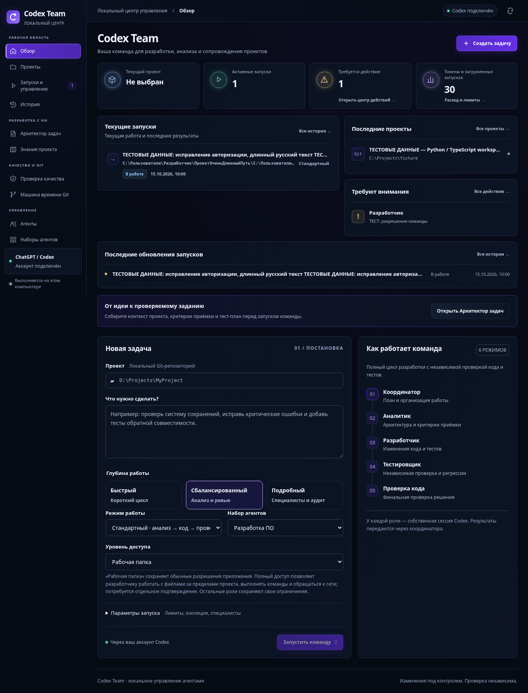
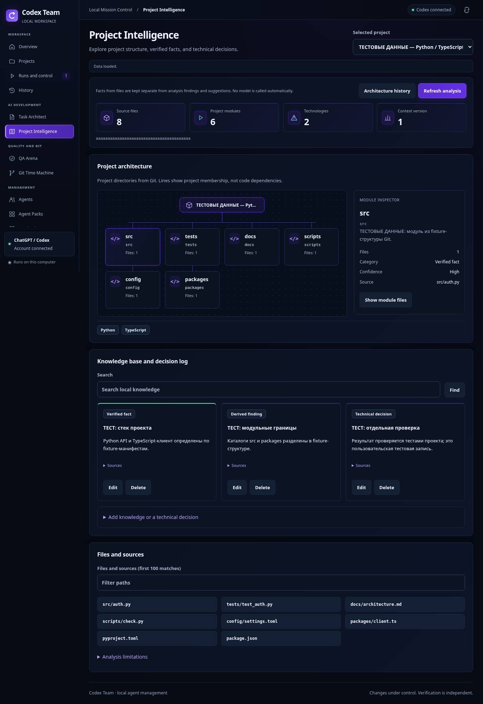
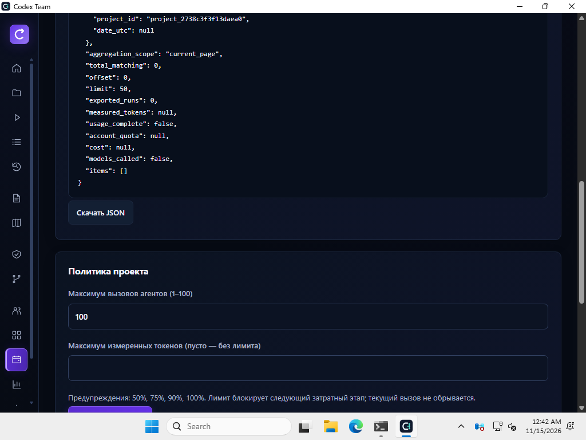

> **RC12 candidate:** [New feature guide](docs/RC12-GUIDE-EN.md) · [Review PR](https://github.com/LosarOS/codex-team/pull/18). Publication awaits final checks and owner approval. [Native JSON Save passed a bounded Windows scenario](reports/evidence/rc12-native-gui/native-gui-proof.json); this is not complete GUI acceptance.

# Codex Team

[Русский](README.md) · [Download for Windows](https://github.com/LosarOS/codex-team/releases/tag/v1.0.0-rc11) · [User guide, Russian](docs/USER_GUIDE.md)


**Your local AI agent team. Under your control.**

Describe a task, choose the team and permissions, follow execution, then inspect the Git changes. Codex Team brings task planning, isolated working copies, history, budgets and result review into a Windows application.

This is an independent LosarOS product, **not an official OpenAI application**. It uses the official Codex SDK. ChatGPT/Codex sign-in is the primary connection method; an API key is optional.

> The current published version is **1.0.0-rc11**, an unsigned prerelease. [Installer EXE](https://github.com/LosarOS/codex-team/releases/download/v1.0.0-rc11/CodexTeam-Setup-x64.exe) · [Portable ZIP](https://github.com/LosarOS/codex-team/releases/download/v1.0.0-rc11/CodexTeam-Portable-x64.zip) · [SHA256](https://github.com/LosarOS/codex-team/releases/download/v1.0.0-rc11/SHA256SUMS.txt). [Evidence and exact limits](reports/engineering-session-2026-10-23.md). Interactive WebView2/DPI acceptance and successful development through a live SDK account still need confirmation.

## From an idea to a reviewable result

**Project → context → task → permissions and budget → explicit start → changes → QA and review → your decision.**

| Tool | What it does |
| --- | --- |
| **Mission Control and queue** | Real events, stages, pending decisions and stop reasons. Independent missions run sequentially after explicit confirmation. |
| **AI Task Architect** | An editable specification, acceptance criteria and test plan. Optional AI refinement requires an explicit action. |
| **Project Intelligence** | Local Git project analysis, source-backed knowledge and decision history. |
| **Project Doctor** | Read-only Windows/.NET discovery: SDK, solutions and build methods. Finding a command does not prove it builds. |
| **Budget Guardian** | Configured budgets, observed calls and available measured tokens. Unknown is not zero; ChatGPT weekly quota is not inferred. |
| **Git Time Machine** | Checkpoints, diffs and recovery into a new worktree while preserving original files. |
| **QA Arena** | Confirmed checks in a prepared local Docker environment. Missing prerequisites mean BLOCKED, never a fabricated PASS. |
| **History** | Search, favorites, personal notes, reports, run comparison and safe preparation of a new task from a saved run. |

One developer owns writes; specialists run sequentially. `max_parallel_agents` does not promise parallel coding. There is no automatic merge, push or silent queue restart.

## Interface

The following six images are **real historical browser/fixture captures** from earlier RCs retained in the repository. They show existing screens, are not RC12 screenshots and do not establish interactive Windows WebView2 acceptance. [Historical UI validation](reports/redesign-rc5/VALIDATION.md).

| Overview | Mission queue |
| --- | --- |
|  |  |
|  |  |
|  |  |

### Native RC12: budget export



Actual portable EXE source `6e00643…`, disposable Windows Server and a synthetic empty selection. The preview starts above the current scroll; unknown tokens/cost/quota remain null. Native Save, the written JSON and graceful exit0 were observed, with no owned processes left and no forced cleanup. [Proof](reports/evidence/rc12-native-gui/native-gui-proof.json) · [Saved JSON](reports/evidence/rc12-native-gui/native-budget-saved.json) · [Capture provenance](docs/screenshots/rc12-native-gui/README.md).

This is one observed scenario, not a final canonical release PASS. Physical Windows/DPI and live SDK development remain NOT VERIFIED. Startup SDK account-discovery call count in the GUI is unknown, not zero.

## Install

1. Download **CodexTeam-Setup-x64.exe** from [RC11 Releases](https://github.com/LosarOS/codex-team/releases/tag/v1.0.0-rc11). `CodexTeam-Setup-x64.zip` contains the installer. “Code → Download ZIP” downloads source code.
2. Verify it against `SHA256SUMS.txt`, for example `Get-FileHash .\CodexTeam-Setup-x64.exe -Algorithm SHA256`.
3. Install for the current user and open the shortcut. **Microsoft Edge WebView2 Runtime** is required; the installer offers Microsoft's official bootstrapper if absent.
4. For portable use, extract **all** of `CodexTeam-Portable-x64.zip` to a writable folder and open `CodexTeam.exe`.

Windows 10/11 x64 is the target platform. Python, the official Codex CLI and Git are bundled; tools and dependencies for every user project are not. Binaries are unsigned and may trigger SmartScreen. [Detailed installation](INSTALL_WINDOWS.md).

## Your first task

1. Connect through the supported ChatGPT/Codex sign-in in Settings. Never post credentials in Issues.
2. Add a local Git project, open its diagnostics and inspect available tools.
3. Describe one verifiable task. Choose **Plan** or **Audit** for analysis, **Standard** or **Implement** for implementation.
4. Review scope of access, isolated working copy and limits. Full access requires separate confirmation.
5. Click Start. Follow real events and the Action Center; read the technical reason if blocked.
6. Inspect the diff, test results and review. Integrate changes yourself: there is no automatic merge.

Queue **independent tasks**. If B needs changes from A, finish and review A before preparing B separately. Preflight checks local facts; it cannot establish account authentication, remaining quota or future model success.

[Full guide, Russian](docs/USER_GUIDE.md) · [Permissions](docs/PERMISSIONS.md) · [Providers](docs/PROVIDERS.md)

## Modes and controls

| Mode | Purpose |
| --- | --- |
| Quick | A small task with implementation and testing |
| Standard / Deep | Implementation with analysis, tests, review and mode-specific additional checks |
| Plan / Audit | A plan or assessment; DONE does not mean code was implemented |
| Implement | Implementation of an already defined task |

Pause takes effect after the current stage; Stop cancels work; Resume uses a saved checkpoint. An unfinished stage may need repeating or an explicit decision. Steering and approval actions depend on supported SDK capabilities. [Limitations](LIMITATIONS.md).

## Settings and local data

Russian and English, themes and accent, agents, packs, drafts and templates are stored locally. Ctrl+K opens the command palette. Personal run notes are not automatically sent to agents.

Installed data: `%LOCALAPPDATA%\CodexTeam`. Portable data: adjacent `data/`; `CODEX_TEAM_DATA_ROOT` can override the location. Before upgrading, fully quit and copy **every data folder you use**. Uninstall preserves user data and projects. Updates are user initiated, not silently installed.

AI execution sends selected project context to the chosen provider. The application has no telemetry or remote application logs. Keep secrets out of specifications, knowledge entries, commands and diagnostic exports.

Optional OpenAI API access needs your key and explicit agreement to separate billing. Windows Credential Manager stores the key. There is no automatic paid-API fallback. Local command policy does not intercept every Codex native shell tool: consider the official environment's sandbox and approvals as well.

## Evidence and limits

[RC11 evidence](reports/engineering-session-2026-10-23.md) records **877 passed / 1 skipped** on Windows and native portable/installed backend, restart, repair/uninstall/reinstall, Unicode shortcuts and profile preservation. Published binaries were downloaded again and verified by SHA256. This is historical **RC11** evidence, not a fresh test of the current working branch.

Successful live SDK development of SHIFT is not verified: attempts stopped at AUTH_REQUIRED. API inference and paid calls were not performed. Physical Windows 10/11, interactive WebView2, DPI, Narrator and full portable GUI acceptance remain outstanding. Synthetic history and fixtures are not live model execution.

## FAQ

**Do I need a subscription?** You need Codex access under your account's terms. Availability and limits belong to the provider; the application does not issue a quota.

**Does it work offline?** History, local analysis and editing do not need a model call. AI execution needs access to the selected provider.

**Why does QA Arena require Docker?** It is a separate isolated QA mechanism. The app does not install Docker or download images automatically. The main desktop application does not require a container.

**Where are the changes?** In the working copy, diff and run history. Review them and the actual check results before integration.

## Development

Python 3.11+ and Git; Windows packaging was checked with Python 3.12. Backend: FastAPI/SQLite. Desktop: pywebview/WebView2. Agent integration: official Codex SDK.

```powershell
.\setup.ps1
.\run.ps1
.\.venv\Scripts\python.exe -m pytest -q
.\build-desktop.ps1
```

`run.ps1` opens browser development mode. Close any server using the same data root before executing CLI tasks. [Architecture](ARCHITECTURE.md) · [Desktop details](DESKTOP_ARCHITECTURE.md) · [Contributing](CONTRIBUTING.md).

[Changelog](CHANGELOG.md) · [Roadmap](ROADMAP.md) · [Release checklist](docs/RELEASE_CHECKLIST.md) · [Troubleshooting](TROUBLESHOOTING.md) · [Security](SECURITY.md) · [Issues](https://github.com/LosarOS/codex-team/issues)

**An application license has not yet been selected.** A public repository does not itself grant MIT or other open-source permissions. The license has not changed; dependencies retain their own terms.
