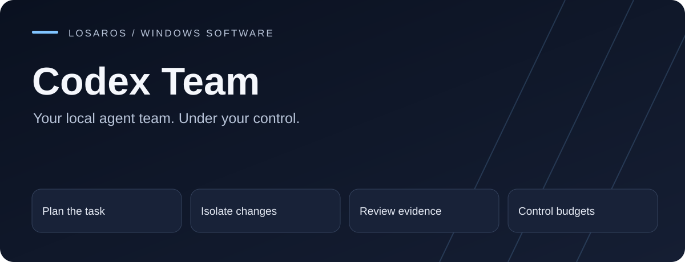
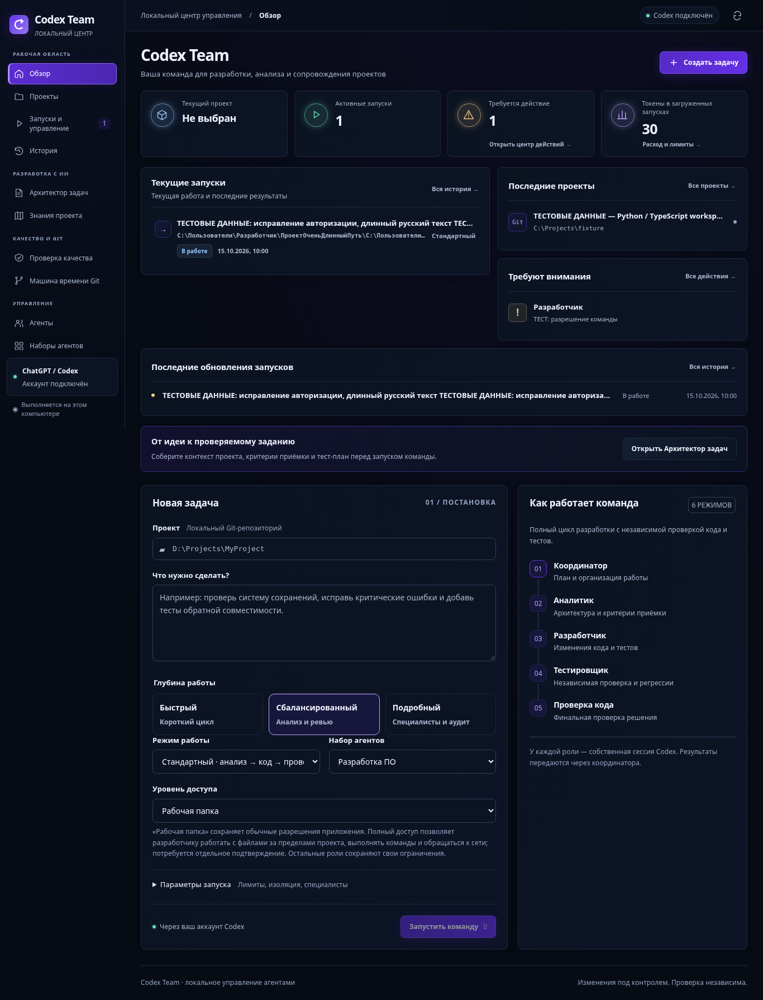
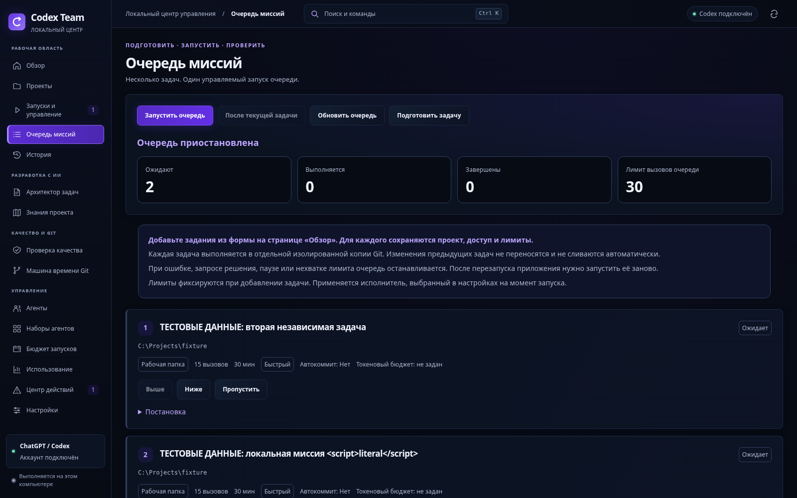
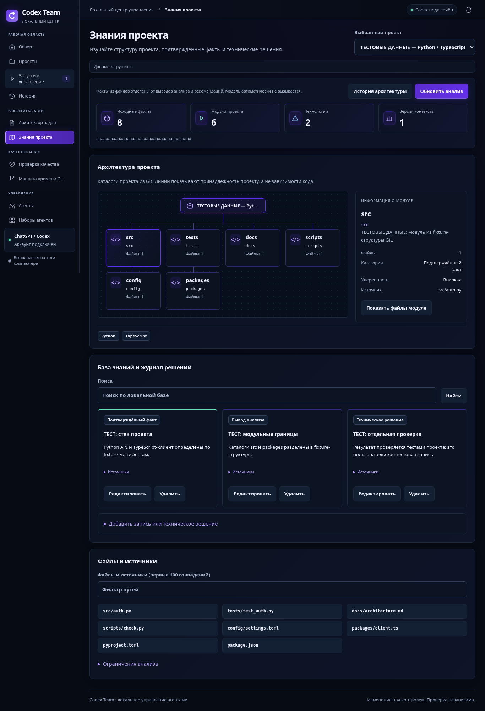
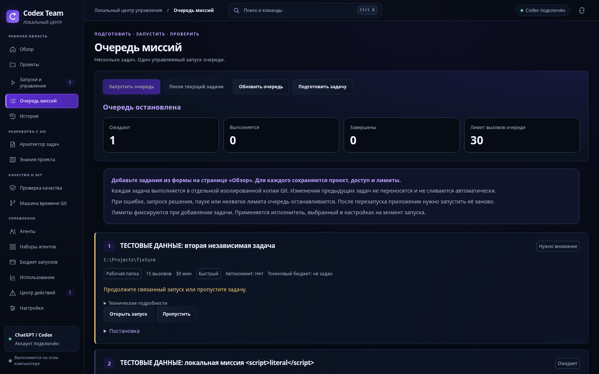
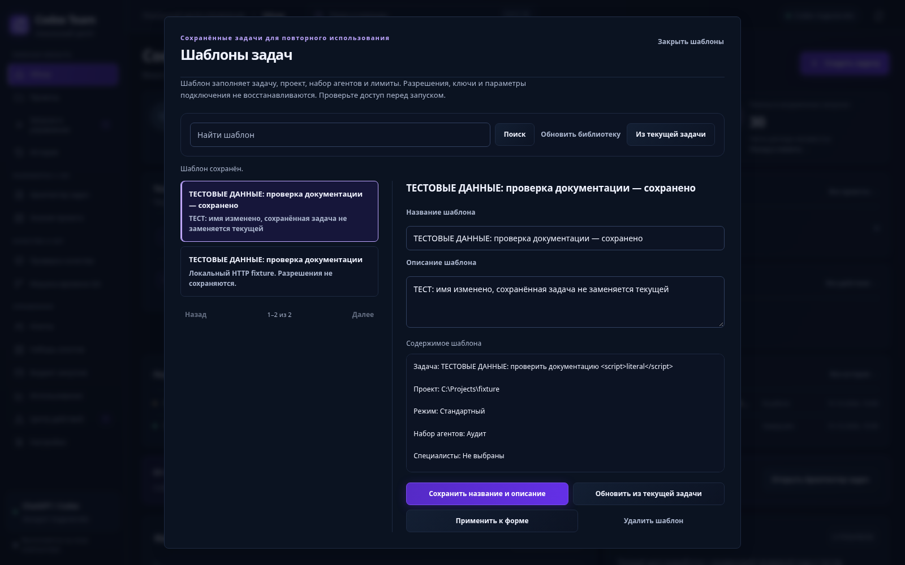
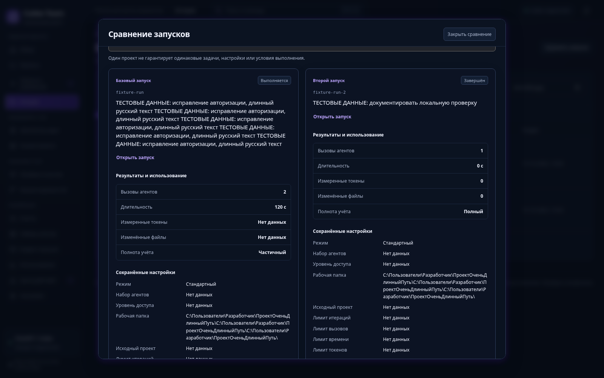
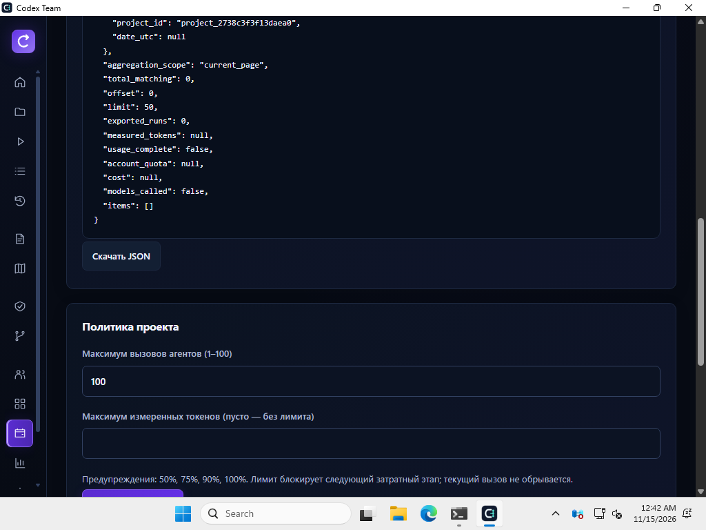

> **Кандидат RC12:** [новые возможности и инструкции](docs/RC12-GUIDE-RU.md) · [PR18](https://github.com/LosarOS/codex-team/pull/18). Публикация ожидает завершения проверок и подтверждения владельца. [Native Save JSON подтверждён в ограниченном Windows-сценарии](reports/evidence/rc12-native-gui/native-gui-proof.json); это не полная GUI-приёмка.

# Codex Team

[English](README.en.md) · [Скачать Windows-версию](https://github.com/LosarOS/codex-team/releases/tag/v1.0.0-rc11) · [Руководство](docs/USER_GUIDE.md)



**Твоя локальная команда AI-агентов. Под полным контролем.**

Поставьте задачу, выберите команду и разрешения, следите за этапами и проверяйте результат в Git. Codex Team объединяет планирование, изолированные рабочие копии, историю, бюджеты и проверку изменений в приложении для Windows.

Это независимый продукт LosarOS, **не официальное приложение OpenAI**. Он использует официальный Codex SDK; основной способ подключения — вход через ChatGPT/Codex. Обязательного API-ключа нет.

> Текущий опубликованный выпуск — **1.0.0-rc11**, неподписанный prerelease. [Установщик EXE](https://github.com/LosarOS/codex-team/releases/download/v1.0.0-rc11/CodexTeam-Setup-x64.exe) · [Portable ZIP](https://github.com/LosarOS/codex-team/releases/download/v1.0.0-rc11/CodexTeam-Portable-x64.zip) · [SHA256](https://github.com/LosarOS/codex-team/releases/download/v1.0.0-rc11/SHA256SUMS.txt). [Отчёт и точные ограничения](reports/engineering-session-2026-10-23.md). Интерактивная WebView2/DPI-приёмка и успешная разработка через живой SDK ещё требуют подтверждения.

## От идеи до проверяемого результата

**Проект → контекст → задача → разрешения и бюджет → явный запуск → изменения → QA и review → решение пользователя.**

| Инструмент | Польза |
| --- | --- |
| **Mission Control и очередь** | Реальные события, этапы, решения и причины остановки; независимые миссии запускаются последовательно отдельным подтверждением. |
| **AI Task Architect** | Редактируемое ТЗ, критерии приёмки и план проверки. Дополнительная AI-подготовка — только явным действием. |
| **Project Intelligence** | Локальный анализ Git-проекта, источники знаний и история решений. |
| **Project Doctor** | Read-only диагностика Windows/.NET, SDK, решений и способов сборки. Обнаружение команды не означает успешную сборку. |
| **Budget Guardian** | Настроенные бюджеты, наблюдаемые вызовы и доступные фактические токены. Неизвестное не заменяется нулём; недельная квота ChatGPT не вычисляется. |
| **Git Time Machine** | Контрольные точки, diff и восстановление в новый worktree с сохранением исходных файлов. |
| **QA Arena** | Подтверждаемые проверки в подготовленном локальном Docker-окружении. Без необходимых условий — BLOCKED, а не фиктивный PASS. |
| **История** | Поиск, избранное, личные заметки, отчёт, сравнение запусков и безопасная подготовка повторной задачи. |

Один разработчик владеет записью; специалисты выполняются последовательно. `max_parallel_agents` не обещает параллельное внесение изменений. Нет автоматического merge результатов, push или скрытого запуска очереди после restart.

## Интерфейс

Следующие шесть снимков — **реальные исторические browser/fixture captures** из предыдущих RC, сохранённые в репозитории. Они показывают существующие экраны, не являются снимками нового RC12 и не подтверждают интерактивную Windows WebView2-приёмку. [Историческая проверка интерфейса](reports/redesign-rc5/VALIDATION.md).

| Обзор | Очередь |
| --- | --- |
|  |  |
|  |  |
|  |  |

### Native RC12: экспорт бюджета



Реальный portable EXE source `6e00643…`, disposable Windows Server, синтетическая пустая выборка. Верх preview вне scroll; неизвестные токены/стоимость/квота остаются null. Подтверждены native Save, фактически записанный JSON и graceful quit с exit0 без оставшихся owned процессов и принудительной очистки. [Proof](reports/evidence/rc12-native-gui/native-gui-proof.json) · [Сохранённый JSON](reports/evidence/rc12-native-gui/native-budget-saved.json) · [Происхождение снимков](docs/screenshots/rc12-native-gui/README.md).

Это отдельный наблюдённый сценарий, не итоговый canonical release PASS. Физические Windows/DPI и live SDK остаются NOT VERIFIED; число штатных SDK account-discovery calls в GUI неизвестно, а не0.

## Установить

1. Скачайте **CodexTeam-Setup-x64.exe** из [RC11 Releases](https://github.com/LosarOS/codex-team/releases/tag/v1.0.0-rc11). Архив `CodexTeam-Setup-x64.zip` содержит тот же установщик. «Code → Download ZIP» скачивает исходники.
2. Сверьте файл с `SHA256SUMS.txt`, например `Get-FileHash .\CodexTeam-Setup-x64.exe -Algorithm SHA256`.
3. Установите для текущего пользователя и запустите ярлык. Нужен **Microsoft Edge WebView2 Runtime**; при отсутствии мастер предлагает официальный загрузчик Microsoft.
4. Для portable полностью распакуйте `CodexTeam-Portable-x64.zip` в доступный для записи каталог и запустите `CodexTeam.exe`.

Целевая платформа — Windows 10/11 x64. Python, официальный Codex CLI и Git входят в дистрибутив; инструменты и зависимости всех пользовательских проектов в комплект не входят. Бинарники unsigned, возможны предупреждения SmartScreen. [Подробная установка](INSTALL_WINDOWS.md).

## Первая задача

1. Подключите Codex через предусмотренный вход ChatGPT/Codex в настройках. Не пересылайте токены или пароли в Issues.
2. Добавьте локальный Git-проект. Откройте диагностику, проверьте окружение и доступные инструменты.
3. Опишите одну проверяемую задачу. Для анализа выберите **Plan** или **Audit**, для реализации — **Standard** или **Implement**.
4. Проверьте область доступа, изолированную рабочую копию и лимиты. Полный доступ требует отдельного подтверждения.
5. Нажмите «Запустить». Следите за реальными событиями и Центром действий; при блокировке прочитайте причину.
6. Изучите diff, результаты тестов и review. Принимайте изменения самостоятельно: автоматического merge нет.

В очередь добавляйте **независимые задачи**. Если задача B требует изменений A, сначала завершите и проверьте A, затем подготовьте B отдельно. Preflight проверяет локальные сведения, а не авторизацию, остаток квоты или будущий ответ модели.

[Полное руководство](docs/USER_GUIDE.md) · [Профили разрешений](docs/PERMISSIONS.md) · [Подключения](docs/PROVIDERS.md)

## Режимы и управление

| Режим | Назначение |
| --- | --- |
| Quick | Небольшая задача с разработкой и тестированием |
| Standard / Deep | Реализация с анализом, тестами, review и дополнительными проверками по выбранному режиму |
| Plan / Audit | План или проверка проекта; DONE здесь не означает реализованный код |
| Implement | Реализация сформулированного решения |

Пауза применяется после текущего этапа, стоп отменяет работу, продолжение использует контрольную точку. Незавершённый этап может потребовать повторения или решения пользователя. Указания текущему/следующему этапу и доступные разрешения отображаются в поддерживаемых механизмах SDK. [Ограничения](LIMITATIONS.md).

## Свои настройки и данные

Русский и английский интерфейс, темы и акцент, агенты, наборы, черновики и шаблоны сохраняются локально. Ctrl+K открывает палитру команд. Личные заметки к запуску не отправляются агентам автоматически.

Установленный профиль: `%LOCALAPPDATA%\CodexTeam`. Portable: соседняя папка `data/`; путь может быть переопределён `CODEX_TEAM_DATA_ROOT`. Перед обновлением полностью выйдите из программы и скопируйте **все используемые каталоги данных**. Удаление приложения сохраняет пользовательские данные и проекты. Обновление запускается пользователем; скрытого автообновления нет.

Для исполнения задачи выбранный контекст передаётся выбранному поставщику AI. Собственной телеметрии и удалённых журналов приложения нет. Не помещайте секреты в ТЗ, базу знаний, команды и диагностические экспорты.

Необязательный OpenAI API требует ключа и явного согласия на отдельную оплату. Ключ хранится в Windows Credential Manager. Автоматического переключения с подписки на платный API нет. Локальная политика команд не перехватывает все native shell tools Codex — учитывайте sandbox и approvals официальной среды.

## Проверки и ограничения

[RC11 evidence](reports/engineering-session-2026-10-23.md) фиксирует Windows suite **877 passed / 1 skipped** и native portable/installed backend, restart, repair/uninstall/reinstall, Unicode-ярлыки и сохранение профиля. Бинарники повторно скачаны и сверены по SHA256. Это исторический результат **RC11**, не новый прогон текущей рабочей ветки.

Успешная живая разработка SHIFT через SDK не подтверждена: попытки остановились на AUTH_REQUIRED. API inference и платные вызовы не выполнялись. Физическая Windows 10/11, полная WebView2/DPI/Narrator и portable GUI матрица требуют отдельной приёмки. История и тестовые fixtures не подменяют живое выполнение.

## Частые вопросы

**Нужна подписка?** Нужен доступ к Codex через ваш аккаунт и его условия; доступность и лимиты определяет поставщик. Приложение не выдаёт собственную квоту.

**Можно работать офлайн?** История, локальный анализ и редактирование доступны без вызова модели; AI-исполнение требует соединения с выбранным поставщиком.

**Почему QA Arena требует Docker?** Это отдельный изолированный механизм QA; приложение не устанавливает Docker и не скачивает образы само. Основной desktop не требует контейнера.

**Где результат агента?** В рабочей копии, diff и истории запуска. Перед интеграцией изучите изменения и фактические результаты проверок.

## Для разработчиков

Python 3.11+, Git; Windows packaging проверялся на Python 3.12. Backend — FastAPI/SQLite, desktop — pywebview/WebView2, агентная интеграция — официальный Codex SDK.

```powershell
.\setup.ps1
.\run.ps1
.\.venv\Scripts\python.exe -m pytest -q
.\build-desktop.ps1
```

`run.ps1` открывает браузерный режим разработки. Перед CLI-выполнением задач закройте сервер с тем же data root. [Архитектура](ARCHITECTURE.md) · [Desktop](DESKTOP_ARCHITECTURE.md) · [Участие](CONTRIBUTING.md).

[Changelog](CHANGELOG.md) · [Roadmap](ROADMAP.md) · [Release checklist](docs/RELEASE_CHECKLIST.md) · [Troubleshooting](TROUBLESHOOTING.md) · [Security](SECURITY.md) · [Issues](https://github.com/LosarOS/codex-team/issues)

**Лицензия приложения пока не выбрана.** Публичный репозиторий не означает MIT или другую открытую лицензию. Лицензия не менялась; зависимости имеют собственные условия.
