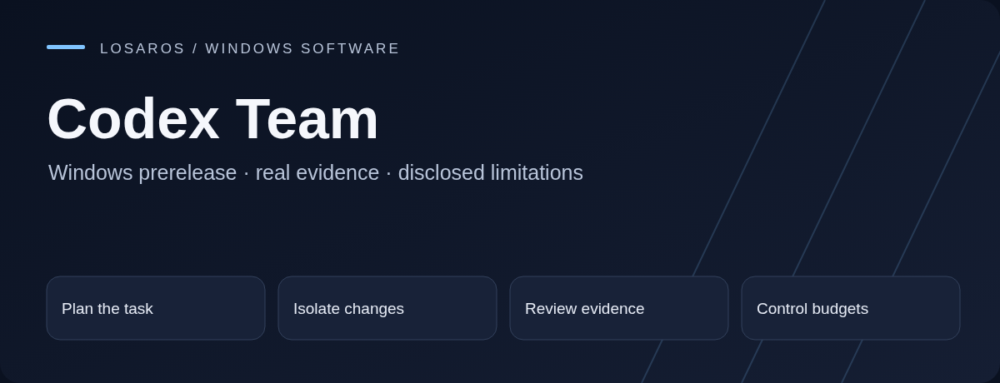

# Codex Team 1.0.0-rc12 — план, контекст и контроль

Предварительная версия RC12. [Full English notes](https://github.com/LosarOS/codex-team/blob/master/docs/releases/v1.0.0-rc12.en.md).

## Что нового

- Редактируемый план Task Architect с критериями, файлами, зависимостями и проверкой циклов; без скрытого исполнения.
- Источники и актуальность локальной памяти, исключение устаревшего контекста и ограниченный предпросмотр.
- Хронология реальных событий Mission Control и понятные следующие действия при блокировке.
- Экспорт текущей страницы фактического использования с фильтрами; неизвестные значения не подменяются нулями. Desktop открывает системный диалог Save и сохраняет заново запрошенный snapshot тех же фильтров; отмена не вызывает скрытый browser fallback.
- Исправлен ложный «Сервер недоступен» при запуске: доступность локального backend проверяется отдельно от медленного SDK; неизвестное состояние не превращается в требование входа.
- Русский основной README, полноценный English и оформление GitHub.

## Интерфейс

Русский / English; сохранены темы Obsidian Violet, Neon Blue, Emerald Tech, Crimson Night и существующие варианты. Новые сценарии используют текущие компоненты, keyboard focus и явные состояния. WebView2 остаётся desktop host.

## Безопасность и совместимость

Существующие permissions, frozen budgets, explicit start, Git isolation и запрет автоматического merge сохранены. Нет скрытых модельных вызовов и платного API fallback. Данные остаются локальными.

## Установка

Используйте CodexTeam-Setup-x64.exe или полностью распакуйте CodexTeam-Portable-x64.zip. Нужен WebView2. Перед обновлением завершите задачи, выйдите и сделайте копию каталога данных.

## Проверки и ограничения

Предварительная проверка кандидата `ccd0500`: Windows1041 passed/1 skipped; Linux1038 passed/4 skipped.16Node suites,8real-backend Chromium сценариев и18сочетаний RU/EN×тем/108layout checks прошли. Настоящий EXE/WebView2 подтвердил актуальный UI backend indicator, portable profile, native Save/записанный JSON и graceful quit0 без force cleanup. Исходные proofs и SHA256: [validation report](https://github.com/LosarOS/codex-team/blob/master/reports/RC12-VALIDATION-RU.md).

Живая SDK-миссия над изолированной копией SHIFT остановилась на AUTH_REQUIRED из-за недействительной refresh-сессии. Попытка1, accepted results нет, токены/модель unknown; полного SDK development результата нет. Неподписанные binaries могут вызвать SmartScreen. Физические Windows10/11, DPI/Narrator/RDP/sleep и полная интерактивная приёмка остаются NOT VERIFIED. Новые планы не являются исполнительным графом зависимых миссий. Экспорт бюджета относится к выбранной странице, не квоте аккаунта.

## English

RC12 adds editable non-executing work plans, source-bound knowledge freshness and bounded context preview, an actual-event mission timeline, and explicit filtered-page usage export. Permissions, isolated worktrees and explicit starts remain unchanged. Unsigned candidate; physical Windows/full GUI/live account acceptance remains separate.

## Публикационная пересборка

Выпуск опубликован с source/tag `2611575e3b814f0ebcf4289f547fe2f196ee8411`. [Windows workflow43695702130](https://github.com/LosarOS/codex-team/actions/runs/43695702130):1041passed/1opt-inDocker skip/0failures. Все13 public assets повторно скачаны и сверены, установочный ZIP содержит тот же EXE. [Файлы, SHA256, исходные proofs и точные ограничения](https://github.com/LosarOS/codex-team/blob/master/reports/RELEASE-PUBLICATION-2026-11-15.md). **VERIFIED PRERELEASE WITH DISCLOSED LIMITATIONS**, unsigned.
